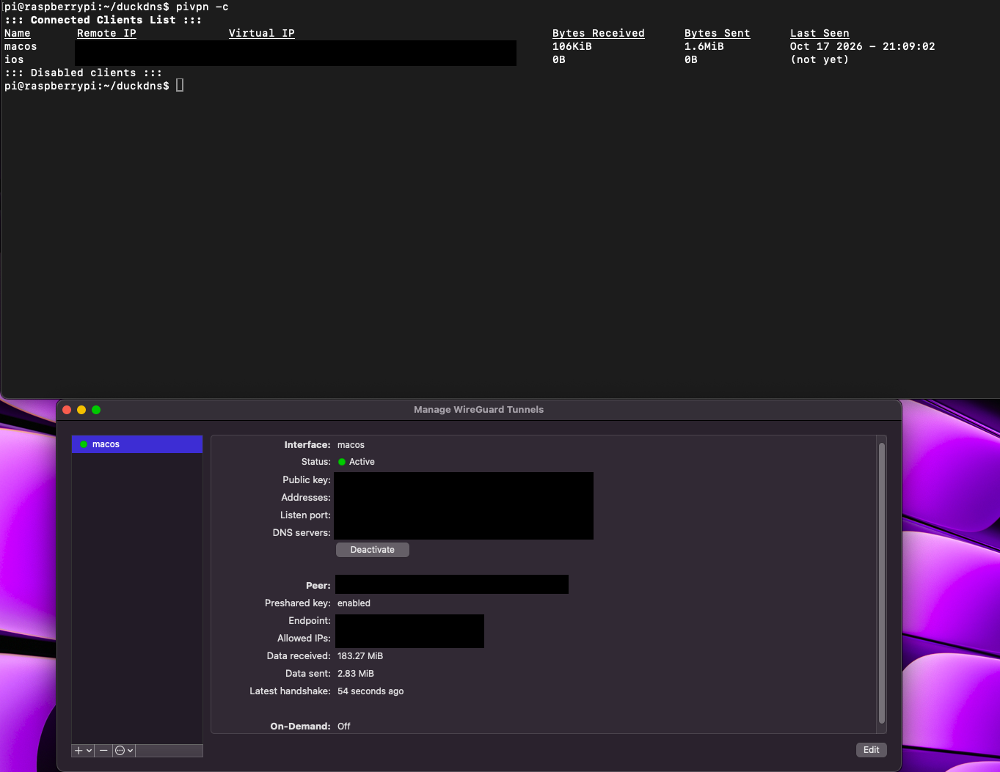

## Summary
This project establishes a self-hosted, full-tunnel VPN gateway on a Raspberry Pi, using the **WireGuard** protocol and **DuckDNS** as the automated Dynamic DNS (DDNS) provider. Deploying this architecture allows remote client devices (such as laptops and smartphones) to securely intercept, encrypt, and route traffic straight back to home network resources from anywhere in the world over untrusted public networks.

---

## Tech Stack

| Component | Technology / Protocol |
| :--- | :--- |
| **Operating System** | Debian Linux on Raspberry Pi OS |
| **VPN Provider** | WireGuard | 
| **Network Protocol** | `UDP` | 
| **DNS Configuration** | DuckDNS |
| **Automation Engine** | Linux `cron` Daemon |

---

## Steps

### Phase 1: Set up Port Forwarding for your VPN server:
 1 - Log in to your router's admin portal (usually can be done by navigating to `https://<ip-of-your-router>`
 2 - Go to your settings to specify and add your port forwarding rule by adding an available port# between `1 and 65535`, UDP as the protocol, and a rule name, if applicable.

### Phase 2: Setup Dynamic DNS with DuckDNS
DDNS allows clients to connect to the VPN server without knowing its IP address by matching the domain name you set up from https://www.duckdns.org with your VPN server's IP address. This will prevent us from having to enter the server's IP address whenever it changes, which our ISP often does.

1 - Create a new script to run DuckDNS: `nano ~/duckdns.sh`.

2 - Inside the script, paste the following (replace <your_token> and <your_subdomain> with your actual token and subdomain):
 `echo url="https://www.duckdns.org/update?domains=<your_subdomain>&token=<your_token>&ip=" | curl -k -o ~/duckdns.log -K -`.
 
3 - Set up a cron job to run this script every 5 minutes:
  `crontab -e`
  
4 - Add the following line to the file:
  `*/5 * * * * ~/duckdns.sh >/dev/null 2>&1`
  * NOTE: This job will run the duckdns.sh script every 5 minutes to match our domain name with the current server's IP address.

### Phase 3: Install WireGuard Server
Setup: https://docs.pi-hole.net/guides/vpn/wireguard/server/#installing-the-wireguard-server

### Phase 4: Add Client configuration
Setup: https://docs.pi-hole.net/guides/vpn/wireguard/client/#add-client-to-server-configuration

---

## Example
Using `pivpn -c` and/or opening the Wireguard app, we can demonstrate a successful connection, in this case from a laptop to the vpn server.

## CLI Cheat Sheet

The following native CLI shortcuts are used to manage client peers, audit data throughput, and analyze infrastructure health directly from the host system terminal:

* `pivpn -c` — shows current peers, handshake times, and transfer stats (wg show)
* `pivpn -d` — runs PiVPN’s debug script to check config and flag common issues
* `pivpn -qr` — prints a QR code of a client config for the mobile app
* `pivpn add` — generates a new client config
